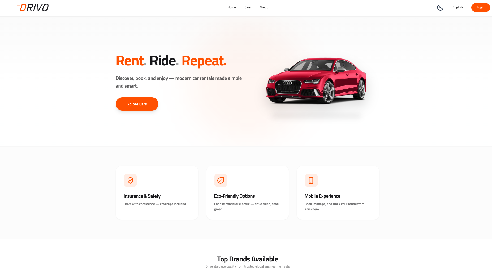
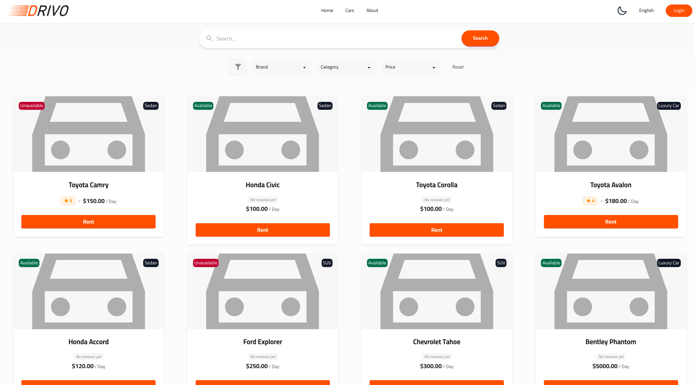
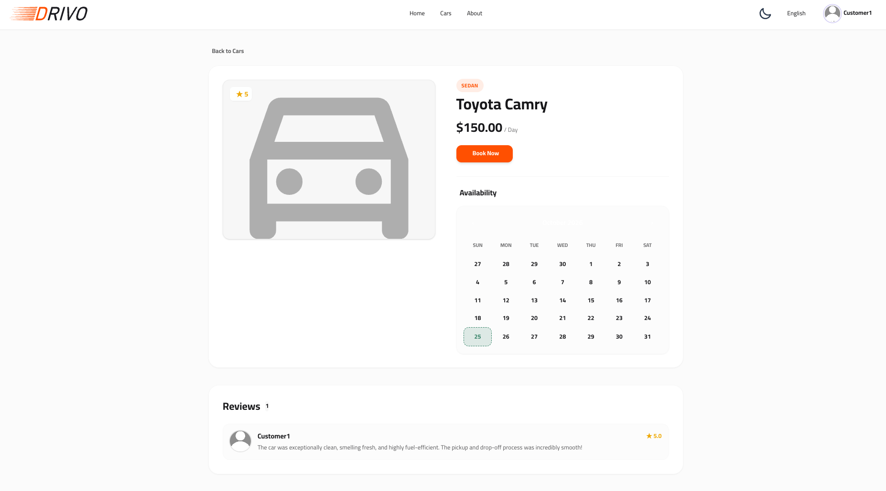
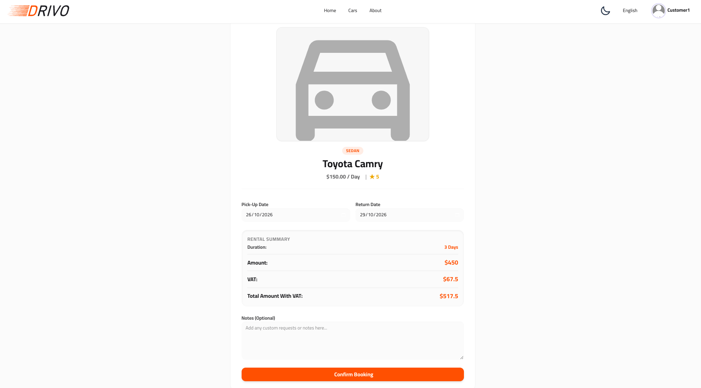
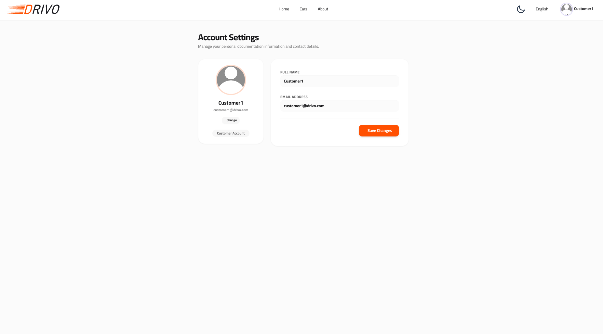
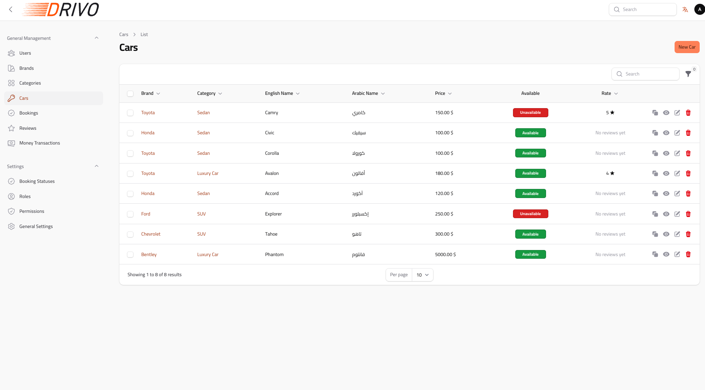
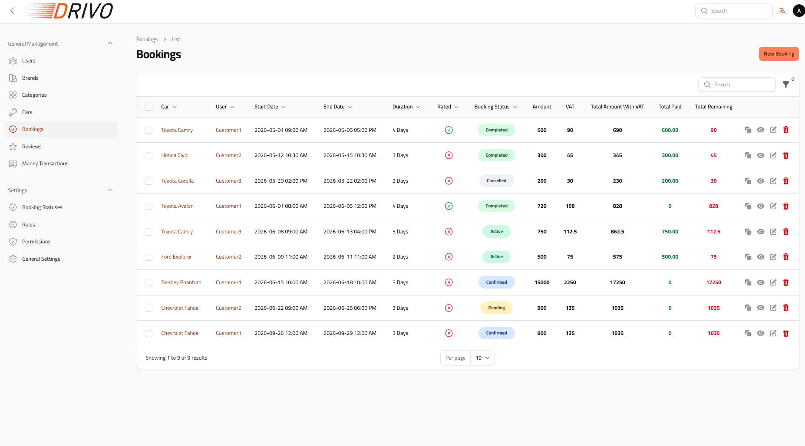
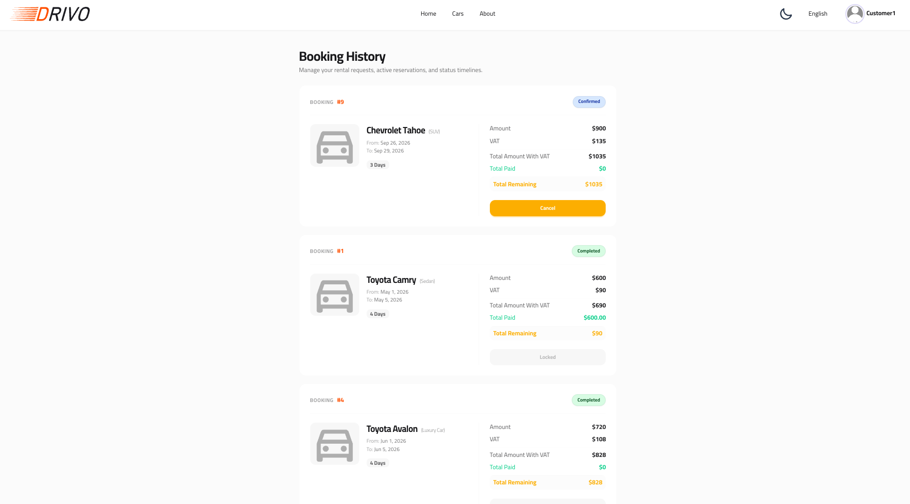

# Drivo - Car Renting Platform 


Drivo is a modern, fully-integrated car rental platform optimized for high performance and engineered to deliver an exceptional user experience. The platform combines a robust backend architecture with responsive, interactive interfaces to provide a seamless rental experience.

---

## Features

### Customer (Client) App:

* Browse cars and filtering by brands or categories
* Book a car within the available dates
* View booking history and details
* Responsive design for mobile and desktop
* Fully supports multi-lingual capabilities (Arabic & English with complete RTL/LTR support) alongside Dark/Light theme switching

### Admin App:

* Advanced Admin Dashboard: Custom-built using Filament v5 to deliver a dynamic, data-driven management panel for efficient, real-time fleet and operational oversight.
* Manage users, categories, brands, cars, and bookings
* View and update bookings
* Tables for orders and products with filtering

---

## Screenshots

### Home Page



### Cars Page



### Booking Page



### Confirm Booking Page



### Profile



### Cars Table



### Bookings Table



### Bookings History



---

## Tech Stack

* Frontend: React.js, TypeScript, Inertia.js (Vite + Tailwind CSS + DaisyUI)
* Backend: PHP 8.5 + Laravel 13
* Database: Configure a supported database through Laravel's environment settings
* Authentication: auth-sanctum + Integrated Google OAuth
* Admin Panel: Filament
* Build Tool: Vite
* File Storage: Local

---

## Requirements

Before installing the project, ensure you have:

* PHP 8.3 or later
* Composer
* Node.js and npm
* A database supported by Laravel

---

## Installation

1. Clone the repository:

```bash
git clone https://github.com/ahmedalhemyari/drivo.git
cd drivo
```

2. Install dependencies:

```bash
composer install
npm install
```

3. Configure environment:

```bash
cp .env.example .env
php artisan key:generate
```

Then update .env file as follows:

* (`.env`):

```
DB_CONNECTION=mysql
DB_HOST=127.0.0.1
DB_PORT=3306
DB_DATABASE=drivo
DB_USERNAME=root
DB_PASSWORD=
```

4. Run database migrations:

```bash
cphp artisan migrate

```

5. Start the application:

```bash
composer run dev

```

---

Contact:

Developer: Ahmed Al-Hemyari (https://github.com/ahmedalhemyari)

Email: ahmed.a.alhemyari@gmail.com

Portfolio: (https://ahmedalhemyari.netlify.app)

Linkedin: (https://www.linkedin.com/in/ahmedalhemyari/)


---

**Drivo** – Fast, scalable, and user-friendly car renting solution.
